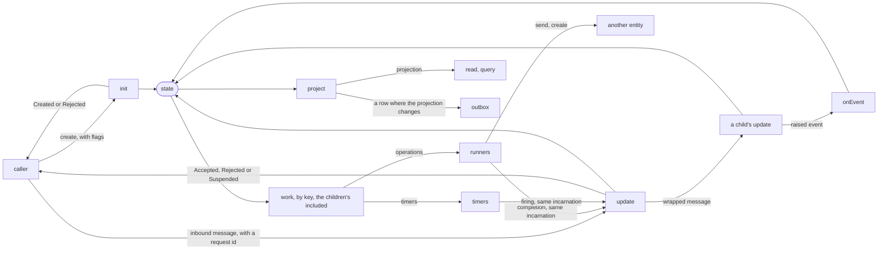

# Design

This is the specification of the library: what each piece of a program does, how the runtime runs it, and what
holds at each point where the process may die. The words it uses are defined in [`glossary.md`](glossary.md), and
[`concepts.md`](concepts.md) shows the pieces and the life of an entity on one page.

## In brief

- **An entity** is one long-lived thing with an id, such as an order. It holds one **state**, and handles one
  message at a time.
- **`update`** is a pure function from a message and the state to the next state. It rejects an inbound message
  that does not apply, and answers an internal message that cannot arrive with a defect.
- **Each step is one transaction.** The transaction locks the entity, reads it, steps the machine and stores the
  next state with the reply to the message, the row callers read and the row of the outbox. No entity is held in
  memory.
- **There are no commands.** `work(state)` derives the operations and the timers under way from the state, by key.
  A key that leaves the state ends its work, and nothing has to cancel it.
- **An operation is data.** Its runner turns it into an effect, and declares what a crash does to it. An idempotent
  one is given the same idempotency key at every try.
- **An incarnation** numbers each run of the work under a key. The runtime drops an answer of a run that is no
  longer the current one.
- **Callers read the projection**, JSON made from the state. A query across entities reads its indexes, and a
  program deployed with the outbox writes a row of the outbox at each step that changes the projection.
- **A defect suspends the entity**, with its state and its message kept, until an operator resumes it with a fix
  or discards the message.
- **Nothing is replayed.** After a crash the runtime reads the state back and starts the work `work` derives from
  it. A new version of a schema reads the version before through a migration.
- **A program is tested with no database to set up and no clock.** A rehearsal runs the runtime's step on a
  database in memory, and the test decides when each operation answers and when time passes.

## Contents

The sections up to [Where it runs](#where-it-runs) are the contract: what a program, its boundary, its tests and an
operator rely on. The last section, [How the runtime keeps it](#how-the-runtime-keeps-it), is for whoever changes
the runtime.

- [What it is for](#what-it-is-for)
- [A program](#a-program), with [what is left to you](#what-is-left-to-you) and its [children](#children)
- [Messages](#messages)
- [Work](#work): [keys with a parameter](#keys-with-a-parameter), [incarnations](#incarnations) and
  [entities that talk](#entities-that-talk)
- [Persistence](#persistence): [what a step costs](#what-a-step-costs), [the tables](#the-tables) and
  [the sweep](#the-sweep)
- [Schemas that change](#schemas-that-change): [checking a program before its deploy](#checking-a-program-before-its-deploy)
- [Execution](#execution) and [what survives a crash](#what-survives-a-crash)
- [Defects](#defects)
- [Reading](#reading)
- [Publishing what happened](#publishing-what-happened)
- [Testing](#testing): [the tests of a program](#the-tests-of-a-program), [rehearsing](#rehearsing) and
  [rehearsing a world](#rehearsing-a-world)
- [Where it departs from effect-tea](#where-it-departs-from-effect-tea)
- [Where it runs](#where-it-runs): [databases](#databases), [deployments](#deployments) and
  [the public surface](#the-public-surface)
- [How the runtime keeps it](#how-the-runtime-keeps-it): [what the storage writes](#what-the-storage-writes),
  [fibers and locks](#fibers-and-locks) and
  [how the machine and the runtime are tested](#how-the-machine-and-the-runtime-are-tested)

## What it is for

A server holds two kinds of state:

- **Rows that requests read and write**, with no life of their own: a profile, a product in a catalogue. A
  request handler is a function from the request to an effect, and the database keeps the state. This library
  is not for them: Effect's HTTP modules already are.
- **Entities that live in time**, whose state changes with events from outside and with the passing of time: an
  order waiting for its payment, a booking held until a deadline, a job with steps and retries. Their bugs are
  the costly ones: a timer that fires after a cancellation, a payment taken twice, a process that died halfway
  through. This library is for them.

An entity is addressed by its id, handles one message at a time, and its state survives crashes, restarts and
deploys. Its program is written as in effect-tea: a pure `update`, states that say which operation is under
way, `reject` for what may arrive and does not apply, a defect for what cannot arrive.

The same intuition is behind Erlang's `gen_server`, Akka Persistence and Restate's virtual objects. What this
library adds is effect-tea's discipline: everything that matters is in the state, and every behaviour is
tested by calling pure functions, crashes included.

## A program

| Piece        | What it does                                                                              |
| ------------ | ----------------------------------------------------------------------------------------- |
| `schemas`    | `state`, `flags`, `inbound`, `internal`, `operation`, `rejection`, `sender`, `projection` |
| `name`       | what the runtime stores the entity under, and what other entities see it as               |
| `keys`       | every key the work under way is held under: a name, or `key` with its parameter's schema |
| `init`       | the first state, from the flags and the time of the creation, or a rejection of the flags |
| `update`     | `(message, meta, children) => (state) =>` the next state, a rejection, or a defect        |
| `work`       | the work under way in each state, by key: operations, as data, and timers                 |
| `operations` | how each kind of operation runs, what it answers, and what a crash does to it             |
| `project`    | what callers read of the state, with the actions it allows, from the children's too       |
| `children`   | the parts the state holds, each placed with `child` or `each`                             |
| `onEvent`    | what the program does with each event a child raises                                      |
| `indexes`    | what a query across the program's entities filters and orders by, read off the projection |
| `migrations` | how the versions before this one are read, in order                                       |

An entity's loop runs every piece of the table, with its children:

A program is declared in one place, `program(schemas)(…)`: the schemas first, which give every type the program
is written in, and then what it does. Everything else is inferred from the pieces — the keys `work` may use,
the messages each kind of operation answers, the names a query may order by, and the services the operations run
in ([decision 0035](decisions/archive/0035-one-place-where-a-program-is-declared.md)).

A program leaves out what it does not have, and each piece left out is empty
([decision 0180](decisions/0180-a-program-leaves-out-what-it-does-not-have.md)). The schemas of the internal
messages, the operations and the reasons left out are `Schema.Never`, and the sender's is `Schema.Null`. `keys`
left out is `[]`, and `operations` and `indexes` left out are `{}`. `work` may be left out only where no key is declared, and
`operations` only where there is no kind of operation, so a program that holds work says what work it holds.
`update` may be left out only where there is no own message, inbound or internal, and leaves the state as it is
then ([decision 0202](decisions/0202-update-is-left-out-where-there-is-no-own-message.md)). A parent whose only
messages are its children's still gives `inbound: Schema.Never`.

There are no commands. Every piece of work that must survive a crash is derived from the state by `work`
([decision 0003](decisions/archive/0003-durable-work-derived-from-state.md)). An operation is data, as effect-tea's
commands are, and its runner sees it, never the state
([decision 0018](decisions/archive/0018-operations-are-data.md)). Everything that leaves the process has a schema: what
is stored, and the projection callers read
([decision 0025](decisions/archive/0025-operations-and-projections-have-schemas.md)), and each of them encodes to what
JSON holds ([decision 0030](decisions/archive/0030-a-schema-encodes-to-json.md)). A program gives the schema of its
senders too: a queued message's origin is stored through it, so a message handled after a restart keeps who sent
it ([decision 0027](decisions/archive/0027-a-program-gives-the-schema-of-its-senders.md)).

A state is an object, as in the Guide ([decision 0031](decisions/archive/0031-a-state-is-an-object.md)). A tag is no rule
of the types, and the Guide's one state machine per concern is how the examples are written: it is also what
gives `work` and `project` a case to match on.

A program is checked where it enters — `deploy`, which a fix is too, and `rehearse` — before anything is stored
or run: one whose name is empty, or one of whose indexes is not a word, is refused. The check is pure and made
once, since a program is never mutated
([decision 0054](decisions/archive/0054-a-program-is-checked-where-it-enters.md),
[decision 0136](decisions/archive/0136-a-key-is-a-name-and-a-parameter-as-data.md)).

A program's types are what `Handle` and `Rehearsal` take. `TypesOf<typeof p>` gives them, of the program
or of a reference to it, so a boundary names the handle it launched as `Handle<TypesOf<typeof order>>`
([decision 0188](decisions/0188-typesof-gives-a-programs-types.md)).

[`examples/order/order.ts`](../examples/order/order.ts) is a whole program.

### What is left to you

The library checks nothing of the rules below. A rule that no type and no defect can hold is added to them.

- **The functions of a program are pure.** The library calls each when it chooses, and as often as it chooses.
- **Nothing that crosses the library is mutated.** The rule holds for the program and its schemas, for its states,
  flags, messages, operations, timers and projections, and for what the library gives back. A new value is a new
  object, as the Guide says of a state. The library relies on the rule. A step whose next state is the same object
  stores nothing callers read, and an operation changed in place is never seen to change
  ([decision 0052](decisions/archive/0052-what-crosses-the-library-is-never-mutated.md)).

## Children

A program may hold children inside its entity, as effect-tea's parent does, stored in its one state
([decision 0133](decisions/archive/0133-an-entity-composes-children-as-effect-tea-does.md)). The library routes each child's
messages, holds its work under its keys, lifts its runners and wraps its reasons, so the composed program is a
program the machine takes as any other. [`examples/cart`](../examples/cart) holds a line of a cart for each article.

### A part

A child is a part, `part(schemas)(…)`: a program's pieces without a name, indexes or migrations, which are the
parent's. Its schemas are a program's, and the sender it reads when it reads one. It leaves out what a program does. A part may also give two schemas
that only type it, since nothing stores what they describe:

- **`event`**, what it raises for its parent. Its `update` returns `raise(event)(state)`, and the parent's
  `onEvent` handles the raised event in the same step.
- **`external`**, what only its parent sends it. An external message is no inbound one: a caller cannot send it,
  so a fact the parent hands down as one truth, a checkout, reaches the child from the parent alone.

A part may hold children of its own, so a tree is as deep as a program needs.

### Declaring children

- **`children`** holds each child: `child(part, { at })` where an optic of Effect focuses, and
  `each(part, { id, at })` for children by id, as the entries an optic focuses, such as
  `Optic.id<State>().key('lines').compose(Optic.entries())`. An id has a schema, and two ids are one when they
  encode alike, as the parameters of a key are.
- **`update`** takes the parent's own messages, `meta`, and `children`: `children.Line.update(id, message)` sends a
  child an external message, and returns the parent's step. A child that rejects it, or is not there, is a defect.
  `andThen` and `forEach` add up the steps of a parent that is itself a part, keeping their raised events.
  `forEach` over messages to children of one name by id puts the children back once, and not once per child, with
  the same step as one message after the other gives. A child that raises an event puts them back before its parent
  handles it ([decision 0155](decisions/archive/0155-a-foreach-of-messages-to-children-puts-them-back-once.md)).
  One `andThen` after the other puts the children back once per message, since `andThen` gives its state at once.
  A step that tells many children is therefore written with `forEach`, over the ids, or over the steps already made
  with `(step) => step` ([decision 0240](decisions/0240-a-step-that-tells-many-children-is-written-with-foreach.md)).
- **`onEvent`** has a handler for each child that raises events, and is required exactly when one does. A handler of
  children by id takes the id first.
- **`project`** takes `children`, with each child's projection: `children.Line(state, id)`.
- **`init`** makes the whole state, and starts a child with the child's own `init`. A part's `init` never rejects:
  the parent calls it, and decides in its own `init` or `update` whether the child starts
  ([decision 0182](decisions/0182-init-may-reject-the-flags.md)).

### What the library derives

- **Messages.** The parent's inbound and internal messages are its own and each child's, as
  `{ _tag: <child>, message }`, with `id` for a child by id. `meta.from` reaches the child as it reached the parent.
  An inbound message to a child that is not there is rejected.
- **Keys.** A child's key is the parent's under `<child>.<key>`. A key of a child by id takes the id as parameter,
  or the id and the key's own parameter as a pair.
- **Operations.** A child's operation is the parent's under the tag `<child>.<tag>`, as
  `{ _tag: 'Line.Reserve', id, operation }`, run by the child's runner with its delivery.
- **Reasons.** A reason a child gives reaches the caller as `{ _tag: <child>, id, reason }`.

A name with a `.` is composition's: a parent whose own key, operation or child has one is refused where it is
declared. A child's name is composition's too. A parent's own message or reason whose `_tag` may be a child's name
does not compile, nor an own operation whose `_tag` may be `<child>.<tag>`. A tag typed `string`, a template that
reaches a child's name, and a schema with no `_tag` that takes any, as a record, are refused alike. The composed
schemas try each child's wrapper before the parent's own schema, and the own schema refuses a value tagged as a
child's, so a cast past the compiler fails where the value is encoded or decoded, and no field is dropped
([decision 0270](decisions/0270-a-childs-name-is-never-an-own-tag.md)). A child that leaves the state with an operation under way is a defect, as any key dropped while its
operation runs. A child that asks its parent to drop it leaves its work first, from a state that holds none: work a
state still holds after its completion runs again, so a parent that kept the child would run it twice. A child by id removed and added again comes back under new incarnations, so an answer of its earlier
run is dropped.

### Where an item goes

An item is inside the entity when a rule holds across it and the rest within one step. It is an entity of its own
when others address it, or when its parent would hold more than one step should write. Inside the entity, it is a
child when it is a concern of its own, which the parent hears of through its raised events and never reads to
decide. Otherwise it is the parent's own state. A parent's step lists the work of every child that is there, so a
step costs more with every child (see [what a step costs](#what-a-step-costs)).

## Messages

A message is one of two kinds, and the rule for a message that does not apply follows from its kind.

- **Inbound** messages come from callers. Each one carries a request id chosen by the caller, and is answered
  `Accepted` or `Rejected`, with the reason `update` gave, if any
  ([decision 0010](decisions/archive/0010-a-rejection-may-carry-a-reason.md)). A caller that retries with the same id
  gets the same answer, and the message is applied once. The boundary gives `send` a `keep`, the time its
  protocol retries for, and `keep` is required, since only the boundary knows that time. The reply is then kept for
  that time from the step that answers, and a retry after it is a new request, applied again. A retry sent before
  the answer is answered by it and is not applied, however short the `keep`
  ([decision 0282](decisions/archive/0282-a-callers-message-offered-before-its-answer-is-answered-by-it.md)). A `keep` of
  `'forever'` keeps the reply for ever. A step that stores a reply deletes its entity's replies past their time, and
  `Handle.expire` those of the whole program, which [the sweep](#the-sweep) runs at an interval
  ([decisions 0125](decisions/archive/0125-a-callers-reply-is-kept-as-long-as-its-boundary-says.md),
  [0245](decisions/archive/0245-a-reply-is-kept-as-long-as-send-says-and-the-runtime-sweeps.md)). A program whose sender is
  `null` takes none, and its callers' requests leave the sender out. Request ids are their
  sender's: another entity's are
  stored under its address, apart from everyone else's
  ([decision 0015](decisions/archive/0015-a-request-belongs-to-its-sender.md)), and a caller's under its sender, as the
  program's schema writes it ([decision 0048](decisions/archive/0048-a-callers-request-belongs-to-its-sender.md)). A
  request is a value — a caller's sender and request id, or the run of another entity's operation and the name it
  gave — stored as its schema writes it, and never parsed out of a string
  ([decision 0059](decisions/archive/0059-a-request-is-a-value.md)).
  A caller's request carries its message too. A second request under a caller's sender and request id is a retry
  only where its message, as the `inbound` schema encodes it with the fields of each object in order, is the same
  text. One that carries another message is answered `Reused`: nothing of it is applied, queued or stored, and the
  first request's reply is kept. So a value whose encoding keeps the order it was built in, as a set, is the same
  request only built alike, and a retry decoded from the same request is. A reply another version stored is
  compared once read through the migrations of `inbound`. A boundary answers `Reused` as a refusal of the caller's
  request, as `422` over HTTP. A program whose sender is `null` keeps one space of request ids for every caller, so
  its boundary gives request ids unique across its callers, as a UUID each. A request after a reply's `keep` is a
  new request, whatever it carries
  ([decision 0269](decisions/archive/0269-a-callers-request-is-its-sender-its-id-and-what-it-carries.md)).
  `meta.from` says who sent it, read off the request, so that
  `update` decides who may do what. An inbound message may arrive in any state: a slow client, a retry, a second
  device, a malicious caller. One that does not apply is rejected.
  The runtime trusts the sender it is given: whoever calls `create` and `send` is the boundary, which
  authenticates the caller and writes the sender as the identity it authenticated. A caller the boundary does not
  authenticate never reaches the runtime, and nothing is stored for it. What a sender may do is domain, so a sender
  that may not is rejected, never a defect
  ([decision 0124](decisions/archive/0124-the-boundary-authenticates-and-update-authorizes.md)).
  A caller may be another entity's operation: `meta.from` is then `Entity`, with the sender's name and id,
  filled in by the runtime (see [entities that talk](#entities-that-talk)).
- **Internal** messages come from the entity's own work: an operation's completion, a timer's firing.
  The runtime delivers one only while its key is in `work(state)`, in the same incarnation that sent it
  ([decision 0004](decisions/archive/0004-incarnations-guard-internal-messages.md)). So an internal message in a state
  where its key is absent cannot arrive. `update` answers it with a defect.

`meta.at` is the time the runtime handles the message, read once, before `update`. A program that needs time
reads it there, and `update` stays pure. A timer's message is the fact that its time has passed: `update`
trusts it, and never compares `meta.at` with the deadline. Another node's clock may be a few milliseconds
behind.

An entity is created by a request of its own, with its flags, answered `Created` once and `AlreadyExists`
after, or `Rejected` where its program's `init` rejects the flags, as the paragraph after this one says. The flags
are stored with the entity, and a caller's retry of the creation that carries other flags is answered `Reused`, as
a message is ([decision 0269](decisions/archive/0269-a-callers-request-is-its-sender-its-id-and-what-it-carries.md)). A
message to an entity that does not exist is answered `NotFound`, and creates nothing
([decision 0012](decisions/archive/0012-creation-is-a-request-of-its-own.md),
[decision 0017](decisions/archive/0017-creation-in-the-machine.md)). A caller gives the flags in the request, as
`create(id, { flags, requestId, sender })`, and a program whose flags are `null` leaves them out
([decision 0245](decisions/archive/0245-a-reply-is-kept-as-long-as-send-says-and-the-runtime-sweeps.md)). A creation and a message may share a request id,
and each is answered apart ([decision 0050](decisions/archive/0050-a-creation-is-answered-apart-from-a-message.md)). `init`
sees no sender, so the program does not decide who may create an entity. The boundary decides it, or an entity
does: the entity's `update` rejects the request, or keeps work whose operation calls `create`. A defect at creation
is given to its creator, and nothing is stored, so a retry after a fix creates the entity
([decision 0124](decisions/archive/0124-the-boundary-authenticates-and-update-authorizes.md)).

A program's `init` may reject the flags, with `reject` or `rejectWith` and the program's reasons, as `update`
rejects a message. A rule of the domain at creation that the flags' schema cannot hold, such as one that reads the
time of the creation, lives there. The creator is answered `Rejected`, with the reason. The runtime stores neither
the entity nor the reply: a retry under the same request id runs `init` again, as a message answered `NotFound` is
applied once its entity exists ([decision 0182](decisions/0182-init-may-reject-the-flags.md)). Another entity's operation is the exception: its
rejection is kept while its work holds, so that a run after a crash is given it again, as
[entities that talk](#entities-that-talk) says.

## Work

`work(state)` returns the work of the state, under the keys the program declares and no others: the names of
the keys are finite, and a name a program computes is not one of them
([decision 0033](decisions/archive/0033-a-program-declares-its-keys.md)). A key may take a parameter, which is data,
as the subsections below say. The types catch a key never declared; a
declared key beside a misspelt one they accept, so the machine checks what `work` returns against `keys`
wherever it reads it, and a key the program does not declare is a defect
([decision 0037](decisions/archive/0037-the-machine-checks-the-declared-keys.md)). So is an operation the program gives
no runner for, which a cast lets through
([decision 0054](decisions/archive/0054-a-program-is-checked-where-it-enters.md)). The runtime compares the work with
the previous state's, as effect-tea compares subscriptions:

- a new key starts its work;
- a kept key leaves it as it is;
- a missing key ends it.

Work ends when its message is handled. In the step that handles it, its key counts as gone, so a next state
that returns it starts new work: that is how a timer repeats
([decision 0008](decisions/archive/0008-delivered-work-is-done.md)).

Two kinds of work exist.

- **An operation** is a value of the program's own type, usually a `Schema.TaggedUnion`, which says what to do.
  The program's `operations` give a runner for each tag, which turns it into an effect that ends with one of the
  internal messages its kind of operation answers
  ([decision 0034](decisions/archive/0034-an-operation-answers-the-messages-of-its-runner.md)). Expected failures become
  messages, as in effect-tea's commands. A transient failure is retried inside the runner, with `Effect.retry` and
  a schedule that ends, under the same idempotency key. Once the schedule ends, the runner delivers a message
  that says so, and the state decides what follows: a new attempt behind a timer, with a count of attempts the
  state holds, or an end. The runtime counts no retries, and never makes a defect of them
  ([decision 0130](decisions/archive/0130-a-runner-retries-and-the-state-counts-the-attempts.md)). The runner says what a
  crash does to it
  ([decision 0011](decisions/archive/0011-an-operation-declares-what-a-crash-does.md)): an idempotent
  one receives an **idempotency key** (the entity's program and id, the operation's key and its incarnation:
  [decision 0015](decisions/archive/0015-a-request-belongs-to-its-sender.md)), and passes it on; one that may
  act twice runs again; one that must act at most once is not run again after a crash, and delivers its
  `unknown` message.
  A restarted operation gets the same idempotency key. A new attempt in a later incarnation gets another. A
  service that caps a key's length gets its digest: a runner declared with `operation.digest` is given the SHA-256
  of the key, in 43 characters of base64url. The key's form is part of the delivery stored with the operation, so a
  deploy cannot change it under an operation under way
  ([decision 0123](decisions/archive/0123-an-idempotent-runner-may-be-given-the-digest-of-its-key.md)). An
  operation leaves the state only through its completion: a step whose next state drops the key of an operation
  still running is a defect ([decision 0005](decisions/archive/0005-an-operation-leaves-only-by-completing.md)).
  A droppable operation, declared with `operation.droppable`, is the exception. It acts on nothing, a computation
  or a read, so a step may drop it or change it while it runs: the runtime interrupts it without waiting for its
  finalizers, and a change starts it again as new work. A crash runs it again. It sends to no entity and creates
  none, since a request acts on its receiver: one that does dies
  ([decision 0128](decisions/archive/0128-an-operation-that-acts-on-nothing-may-be-dropped.md)). A droppable runner whose
  services hold `Entities` does not compile, and the runtime's check is for one that escapes the type
  ([decision 0129](decisions/archive/0129-a-droppable-runner-that-sends-does-not-compile.md)).
- **A timer** delivers one internal message at a time. It may be dropped in any state, since it has done
  nothing yet. `timer(at, message)` takes no type parameter: the message keeps its literal tag, and `work`
  checks it against the program's internal messages
  ([decision 0181](decisions/0181-a-timer-needs-no-type-parameter.md)). A timer is due at a whole millisecond, as
  the storage holds it, and a timer due between two is a defect
  ([decision 0266](decisions/0266-a-timer-that-catches-up-fires-with-a-due-time-that-grows.md)).

A stream from a socket or a feed is no work of a program, since it dies with the process. The boundary reads it,
and sends each item as an inbound message, under a request id it derives from the item's offset or id, so that an
item sent again after a crash gets the stored reply. `update` rejects an item the state does not want
([decision 0127](decisions/archive/0127-a-live-stream-feeds-its-entities-from-the-boundary.md)).

The boundary acknowledges an item to its source once `send` answers `Accepted` or `Rejected`, since every other
answer stores nothing of the item. After `Suspended` it sends the same item again, under the same request
id, after a wait. After `NotFound` it creates the entity and sends again, or drops the item on purpose and logs it.
After `Reused` it stops without acknowledging, and an operator decides. A source gives an item again after a crash
between the answer and the acknowledgement, which may come after the `keep`. So the entity keeps the offset of the
last item applied and rejects an item at or before it, or the boundary gives a `keep` of `'forever'`. A discard does
not get a stream past an item the entity dies on, since the item sent again is a new request: the boundary skips it,
or a fix applies or rejects it. An entity that stays suspended holds the items after its own
([decision 0272](decisions/0272-a-boundary-acknowledges-an-item-once-its-answer-is-stored.md)).
[`examples/stream`](../examples/stream) is such a boundary.

A kept key keeps its work only if the work is the same as it is stored: an operation that encodes to the JSON of
the one under way, a timer at the same time whose message encodes alike. A property a schema does not declare is
not stored, and makes no difference: what a step compares is what a crash compares
([decision 0058](decisions/archive/0058-work-is-compared-by-what-is-stored.md)). A timer that changes is armed again, as new work. An operation
that changes while it runs is a defect, as one dropped is: otherwise an operation restarted after a crash,
built from the stored state, would act with other parameters under the same idempotency key. The rule holds
until `update` is given the operation's message, even while its completion waits in the mailbox and a crash
could no longer rebuild it: the program sees the step that handles the message, never the moment the completion
is recorded. A key whose kind changes, from a timer to an operation, is new work
([decision 0014](decisions/archive/0014-rules-the-machine-settled.md),
[decision 0018](decisions/archive/0018-operations-are-data.md)).

What runs is always what the state says. After a crash the runtime does not look for what was running: it
computes `work(state)` again. It compares that with the work stored with the state, so that a new program,
after a deploy, keeps the incarnations of the same work and starts anything else as new work. A new program that
changes or drops an operation under way, delivers it otherwise, or bears another name is a defect
([decision 0020](decisions/archive/0020-a-new-program-is-checked-against-the-stored-work.md),
[decision 0022](decisions/archive/0022-a-new-program-keeps-what-work-started-with.md)).

### Keys with a parameter

A program lists its keys. A key without a parameter is its name, and a key with one is `key(name, schema)`, as in
`keys: ['fee', key('charge', Schema.String)]`. A name listed twice is a defect where the program is declared
([decision 0197](decisions/0197-a-program-lists-its-keys-and-key-gives-one-a-parameter.md)). Each name is a
literal type: a list written outside the call without `as const` is typed `string[]`, and does not compile
([decision 0199](decisions/0199-a-list-of-keys-names-each-key-by-a-literal-type.md)). Under a key with a
parameter, `work` returns a list of pairs, each a parameter and the piece of work under it. An order holds a charge
for each of its lines so, in the step that changes the order
([decision 0132](decisions/archive/0132-a-key-may-take-a-parameter.md)).

A key is a name and a parameter, as data: the declared name, and the parameter as its schema encodes it, with the
fields of each object in order. A key without a parameter has none. So two parameters that encode alike are one
key, as two pieces of work that encode alike are one piece of work. A parameter its schema refuses is a defect, and
so are two pieces of work whose parameters encode alike. Every output, message, suspension and row that names a key
holds the name and the parameter apart, and nothing reads a key's text to tell them apart
([decision 0136](decisions/archive/0136-a-key-is-a-name-and-a-parameter-as-data.md)). The idempotency key holds the name,
or the name and the parameter's JSON, in place: `["Order","o-1",["charge","line-7"],4]`.

### Incarnations

Each run of a key's work has an incarnation, drawn from one counter of the entity, stored with its row. Work that
starts anew under any key draws the next one: work under a key that comes back after leaving, that comes back after
its work delivered, that changes kind, or a timer that changed. An internal message carries the incarnation of the
work that sent it, and the runtime drops it when the key's incarnation has moved on. The counter never goes back,
so a key whose work is gone has no row: when it comes back, it draws an incarnation no run of it had
([decision 0132](decisions/archive/0132-a-key-may-take-a-parameter.md)).

Without it, the second attempt of a payment could receive the late answer of the first. The runtime makes this
impossible, so that no program has to remember attempt numbers.

### Entities that talk

An entity sends a message to another from an operation, with `send(receiver, id, message, name)`, and creates one
with `create(receiver, id, name, flags)`, whose flags come last and are left out where the receiver's flags are
`null` ([decision 0245](decisions/archive/0245-a-reply-is-kept-as-long-as-send-says-and-the-runtime-sweeps.md)). The runtime gives
each run of an operation its own `Entities`, so the request is that run's — its entity, key and incarnation — under
the name, whatever the operation's delivery, and no operation can send under another's
([decision 0060](decisions/archive/0060-send-and-create-take-no-key.md)): an operation that sends twice under one name to
the same entity dies ([decision 0047](decisions/archive/0047-a-request-of-an-operation-has-a-name.md)). A restarted operation sends
the same requests, and gets the receiver's stored replies, kept while the work that sent them is stored
([decision 0021](decisions/archive/0021-a-reply-is-kept-while-the-work-that-asked-holds.md)). An answer no entity
stores is kept for the operation the same way: a creation `init` rejected, and a message's `NotFound`. A run after a
crash is given the kept answer, though another creator has made the entity since, and its message is not applied
([decision 0253](decisions/archive/0253-an-answer-no-entity-stores-is-kept-for-the-operation-that-was-given-it.md)). What an operation's
request carries is not compared, since the runtime makes the request and no two intents share it. A run after a crash
that builds another message, or other flags, under a name is given the reply of the first one, which alone the
receiver holds. So an operation whose completion reports what it sent builds the message from its stored value and
the replies it was given, never from what it reads again
([decision 0269](decisions/archive/0269-a-callers-request-is-its-sender-its-id-and-what-it-carries.md)). While the receiver is
suspended, `send` waits for its resumption, and an operation that reaches a program not deployed yet waits for
its deploy ([decision 0045](decisions/archive/0045-an-operation-waits-for-a-program-not-deployed-yet.md)). The
operation sends again after the launch's `retry`, 50 ms by default. A resumption or a deploy in the sender's own
process ends the wait sooner. A resumption or a deploy in another process is seen at the retry. A receiver's
transaction that fails in the database, as a deadlock fails it, gives no reply either, and the operation sends
again at the retry. Only a defect of the sender's own suspends it. An operation creates an
entity the same way, with `create` and a name. Both name the receiver by its program, or by a *reference*:
`reference<typeof inventory>('Inventory')` is the program's name with its types, made where an `import type` brings
none of its code. The compiler checks the name against the program's, and the runtime reads only the name. A
program whose name is typed `string`, as one typed `Program<T>` by hand, has no reference, since no name could be
checked against it, and a sender passes the program itself. Two
programs that talk both ways import only each other's types, and a program compares a sender's name with a
reference's ([decision 0183](decisions/0183-a-receiver-is-named-by-a-reference.md)). An operation that talks only to
entities may run at least once:
run again, it sends the same requests, and acts once. `update` never sends: a step never waits on another entity
([decision 0009](decisions/archive/0009-entities-talk-through-operations.md)).

[`examples/booking`](../examples/booking) holds seats in an event's inventory this way, and releases them when
the booking is cancelled or expires.

## Persistence

After each message the runtime stores, in one transaction that locks the entity first:

- the new state, when the step changed it;
- the work the state holds, by key, with its incarnation and how each operation is delivered, and the last
  incarnation the entity drew;
- the message, marked as handled, with its reply for an inbound one;
- and, when the state changed, the row a query reads: the projection, and the value of each index on it
  ([decision 0032](decisions/archive/0032-a-projection-is-a-row.md));
- and, when the projection changed and the program is deployed with the outbox, the row of the outbox that other
  systems learn from (see [publishing](#publishing-what-happened)).

It stores the state, not the messages that led to it: a fixed `update` changes what happens next, never what
already happened ([decision 0002](decisions/archive/0002-store-the-state-not-the-messages.md)). The messages may be
kept as an audit, but nothing replays them.

### What a step costs

A step writes the state whole. A step that changes the projection writes it in the read model. A program deployed
with the outbox writes that projection once more, in the step's row of the outbox.
The spike `spikes/large-states.test.ts` saw a step take about 5 ms with a state of 48 KB, 21 ms with 0.5 MB and 240 ms with 5 MB, when the projection holds
the state. It took about a third of that from 0.5 MB up when the projection holds a count. The spike
`spikes/many-children.test.ts` saw a parent's step take 3.5 ms with 1 000
children by id and 10 ms with 10 000, about half as much again as a flat state of that size takes. Such a step is
synchronous, and holds every other entity of the process while it runs.

So the runtime refuses no state for its size. A large state is split by the program:
an item goes into an entity of its own
once its parent would hold more than one step should write
([decision 0135](decisions/archive/0135-a-large-state-is-split-by-the-program-and-the-runtime-warns-of-it.md)).

### The tables

The runtime writes all of it through the program's schemas, as JSON, in tables of its own: the entity, the
keys with their incarnations and work, the mailbox in order, the replies by request, the answers kept for an
operation, the waits for a resumption, the read model and the outbox ([`src/storage.ts`](../src/storage.ts)). Every
table, index, trigger and function the runtime makes is named with `effecttea_`, as `effecttea_entities`, so that
the tables of an application in the same database are never taken for its own. The prefix is fixed, and an
application names no table of its own with it. A launch on a database that already holds an object under one of the
runtime's names dies, and leaves none of the runtime's objects behind
([decision 0218](decisions/0218-the-prefix-is-effecttea-and-a-launch-dies-on-a-name-taken.md)). On
PostgreSQL the runtime makes every object in the schema that the client's `search_path` names first. A launch dies
where a schema further on the `search_path` holds the tables, and makes nothing, since the database cannot tell a
schema put in front of them on purpose from one made later by chance
([decision 0263](decisions/0263-a-launch-dies-where-a-schema-further-on-the-search-path-holds-the-tables.md)). Only `effecttea_migrations` is named with that schema, which
`current_schema()` gives, since `Migrator` would otherwise find it in any schema of the `search_path`
([decision 0217](decisions/0217-tea-migrations-is-named-in-the-schema-the-tables-are-made-in.md)). A launcher that sets the `search_path` of the runtime's role
puts them in a schema of their own ([decision 0215](decisions/0215-the-runtimes-tables-are-made-in-the-schema-of-the-search-path.md)). Each row carries the version of the program that wrote it, and is read
by migrating its JSON to the program's version (see [schemas that change](#schemas-that-change)). The row around
the JSON is read through its table's schema, which says what the storage writes: nothing is filled in or cast, and
a row it refuses fails the call that meets it ([decision 0062](decisions/archive/0062-a-row-is-read-through-a-schema.md)). A schema whose
encoded side is not JSON does not compile: a time is held as `Schema.DateTimeUtcFromMillis`, not as
`Schema.DateTimeUtc` ([decision 0030](decisions/archive/0030-a-schema-encodes-to-json.md)). `Json` is Effect's
`Schema.Json`, under the name the library had for it ([decision 0098](decisions/archive/0098-json-is-effect-s.md)). A value its schema refuses,
or that encodes to a number JSON does not hold (`NaN`, `Infinity`) or to an array with a hole, cannot be stored.
The machine encodes what a step would store, and a step that would store such a value is a defect; an inbound
message that does not encode is its caller's defect,
and reaches no entity ([decision 0040](decisions/archive/0040-what-is-stored-encodes-to-json-as-it-is.md)). So are flags
that do not encode: `init` sees only flags its schema takes
([decision 0049](decisions/archive/0049-flags-are-checked-by-their-schema.md)). A `-0` is stored as `0`, which it
equals ([decision 0210](decisions/0210-a-sparse-array-is-no-json-and-negative-zero-is-read-as-zero.md)). A
rejection's reason is given as a caller reads it from its JSON, so a first reply and a retry give the same reason,
`-0` as `0` ([decision 0214](decisions/0214-a-rejections-reason-is-given-as-a-caller-reads-it.md)).

How the machine and the storage write these rows, and how a reply is kept and deleted, is under
[what the storage writes](#what-the-storage-writes).

### The sweep

The runtime runs `expire` on each program it deploys, at an interval. `launch` takes `sweep`, as `{ millis }`,
every 300 000 ms by default, or `'none'` to leave `expire` to an operator. The first sweep runs one interval after
the deploy. A sweep that fails logs a warning with its cause, and the next one runs at the next interval. A `sweep`
that is neither `'none'` nor a positive integer of millis is the launcher's defect. A sweep changes no answer. It
deletes only the callers' replies past their `keep`, and the replies and the answers kept for work of another entity
that has ended. `expire` deletes in batches, and each batch is a transaction of its own, so that a sweep holds
SQLite's one writer for a short time. SQLite gives no room back to the volume once rows are deleted, so a sweep
bounds the growth of the file and shrinks nothing. The sweep deletes no row of the outbox.

## Schemas that change

A program's schemas are what is stored, so a version of the program that changes one finds the version before it
in the database. `migrations` is how it reads it, in order: the first is the step from version 1 to version 2,
and **the program's version is how many migrations it carries, plus one** — a migration is the bump, and there is
none to declare ([decision 0036](decisions/archive/0036-a-migration-is-a-function-on-the-json.md)). A rejection's reason
is kept as long as the reply that carries it: a caller's for the time its boundary gave, or for ever
([decision 0125](decisions/archive/0125-a-callers-reply-is-kept-as-long-as-its-boundary-says.md)), and an entity's until the work
that asked ends. The migrations of `rejection` are kept as long as a reply of a version they read is stored
([decision 0100](decisions/archive/0100-a-reason-is-kept-as-long-as-a-reply-of-its-version.md)).

A migration is a record of pure functions **from the JSON a version wrote to the JSON the next one reads**, by
kind of stored value: `state`, `flags`, `operation`, `inbound`, `internal`, `rejection`, `sender` and `projection`,
and a kind left out is unchanged. `flags` reads the flags stored with the request that created an entity, which a
caller's retry of the creation is compared with, and `inbound` reads the message of a stored reply too. Both are
read as the migrations write them, and not decoded
([decision 0269](decisions/archive/0269-a-callers-request-is-its-sender-its-id-and-what-it-carries.md)). It works on the JSON, which every schema encodes to
([decision 0030](decisions/archive/0030-a-schema-encodes-to-json.md)), so the types and schemas of the version before do
not live on in the code.

Every row carries the version that wrote it, and is read by migrating its JSON from that version and decoding it
with the program's schema: the machine sees values of the program's own version only. A row is written at the
program's version whenever an event writes it, and an event writes only what it changed: the state, a key, a
message in the mailbox, a reply and the row a query reads are migrated at every read until they are written again
([decision 0057](decisions/archive/0057-the-machine-gives-what-is-written.md)), and
`reindex` writes the read model again, which a deploy that changed the projection's schema runs, as one that
changed an index does.

This is what lets a deploy change the shape of an operation under way: the stored operation, migrated, must be
the one the new `work` computes from the migrated state, and a migration that gives anything else suspends the
entity at its activation, as a program that changes an operation does
([decision 0020](decisions/archive/0020-a-new-program-is-checked-against-the-stored-work.md)). A row written by a version
the program does not have is not read at all: the call that meets it fails, and the process serves the entities
it can read ([decision 0043](decisions/archive/0043-a-row-no-version-reads-fails-what-reads-it.md)). `reindex` is
the exception, since it meets every row: it passes over such an entity, and names it
([decision 0122](decisions/archive/0122-reindex-leaves-a-row-it-cannot-compute-and-names-its-entity.md)).

A program keeps every migration it ever had, since a row is migrated only when it is written again
([decision 0126](decisions/archive/0126-a-program-keeps-every-migration-and-a-test-records-what-each-did.md)). A migration
once deployed is never changed, since it is how a version that exists in storage is read. A test records cases of
each migration: a JSON value a version wrote of one kind, and the JSON value the next version reads of it.
`migrationViolations` checks the program against them.

### Checking a program before its deploy

`check(program, { limit })` finds, before a deploy, the stored entities a new program would not run. It reads each
entity as an activation reads it, through the new program's migrations and from a snapshot of the entity's own, and
steps its activation with the machine, in memory. Inside a transaction the caller left open, each entity is read at
the caller's level, as [Databases](#databases) says. So it runs `work`, `project` and the indexes on the stored
state, compares the operations under way with the new `work`, and calls the `unknown` of an at-most-once operation
that may have run. A suspended entity is stepped as a `resume` by the new program would activate it, and the
message it died on is not handled. The check launches nothing, holds nothing and writes nothing, so it runs on the
database the old version holds ([decision 0247](decisions/archive/0247-check-reads-the-stored-entities-as-a-deploy-would-activate-them.md)).
On SQLite the check's client is opened `readonly`. A writable client of `@effect/sql-sqlite-bun` begins each
transaction with `BEGIN IMMEDIATE`, which waits for the old version's steps even where it only reads
([decision 0267](decisions/0267-a-file-of-sqlite-is-held-by-a-file-of-its-own-and-refuses-no-reader.md)).

It gives the entities not suspended and the suspended ones apart: how many it checked, how many fail, and the first
`limit` failures in the order it read them. A failure is `Load`, a migration or a schema that dies on a stored row,
so that every activation of the entity dies, or `Activation`, an activation that suspends the entity. Each gives
its cause, as a suspension renders it. What the runtime throws fails the whole call, as it fails `reindex`. The
entities are read by pages of their ids, so the check is a reading of a moment: an operation under way at the check
may have ended by the deploy. The check dies on tables that a
migration of another release made, since it migrates nothing: `effecttea_migrations` must record every migration of
this release's `createTables`, and no other. The program is refused as a deploy refuses it, before any row is read.
`limit` is a non-negative integer, required, and a `limit` of 0 gives the counts alone, since one broken program may
fail every entity. The check leaves out the handling of the mailbox's first message by `update`, and the rows of
the read model, which `reindex` writes ([decision 0247](decisions/archive/0247-check-reads-the-stored-entities-as-a-deploy-would-activate-them.md)).

## Execution

- **An event is one transaction.** The transaction locks the entity, reads the time and the entity, steps the
  event with the machine, handles the mailbox until it is empty or the entity is suspended, and commits. The time
  is read after the lock, so a transaction that waited for another steps at the time it holds the entity. No entity
  is held in memory between two transactions. The process holds only the fibers of the operations that run.
- **Activation.** The runtime reads the state, the incarnations and the stored work, computes `work(state)`,
  compares it with the stored work, starts its operations and arms its timers. An entity is activated once a
  launch, in its first transaction of the process. The process remembers the last 10,000 entities it activated, and
  one it forgot is activated again, which writes nothing where the stored work agrees with the program. A
  transaction also activates an entity whose stored operation has no fiber in this process, as after a crash, so
  that the operation runs again. A deploy activates the entities with an operation or a message stored, and the
  others are activated at their next transaction.
- **A message.** It reads `meta.at`, calls `update`, checks the step (defects included, and `work`,
  `project` and the indexes on the next state), stores it, answers the caller, and starts or ends the work
  whose keys changed.
  An internal message `update` rejects is a defect, since it cannot be late
  ([decision 0014](decisions/archive/0014-rules-the-machine-settled.md)). A message is received and handled in the
  transaction that records it. A suspended entity is the exception, and holds its completions behind the message it
  died on. A burst of callers' messages waits for the entity's lock, and nothing of a message
  is stored before its transaction commits.
- **A timer.** Each deployment has one fiber, the waker, that reads the entities with a timer due, fires each timer
  in a transaction of its entity, and sleeps until the earliest time stored, or until a step arms an earlier one. A
  suspended entity's timer does not fire until an operator resumes it.

These rules are a pure state machine, [`src/machine.ts`](../src/machine.ts): its events are a message arriving,
an operation completing or dying, a timer firing, a step, the process dying, and an operator resuming or
discarding. A runtime interprets its outputs ([decision 0013](decisions/archive/0013-the-runtime-is-a-pure-machine.md)).
The program is not part of the machine: each event is stepped by the program that runs the entity, and a deploy
is a `Restart` stepped by another one, so the machine and the runtime never see two programs
([decision 0064](decisions/archive/0064-the-program-is-not-the-machines-state.md)).

## What survives a crash

| The process dies…                                                      | After the restart                                                                 |
| ---------------------------------------------------------------------- | --------------------------------------------------------------------------------- |
| before a step's transaction commits                                    | nothing of the step was seen: the message is handled again, a caller's on retry   |
| after the commit, before the reply reaches the caller                  | the caller retries with the same request id, and gets the stored reply            |
| after the commit, before the work it started                           | activation computes `work(state)` and starts it                                |
| while an operation runs, its effect done in the world but not recorded | it runs again, with the same idempotency key, or delivers `unknown` if at most once |

A message to an entity that is not suspended is handled in the transaction that records it, so a process killed
between the two stored neither. An
operation whose completion was not stored then runs again or delivers `unknown`, as on the fourth line. A timer
whose firing was not stored fires again from the state.

The fourth line is the one the library cannot close. An effect on the world is at least once, or at most once
and then perhaps not at all. A service with idempotency keys, such as a payment provider, makes it exactly once.
One without them, such as an email, may act twice, or is declared at most once, and the state says when it is
not known ([decision 0011](decisions/archive/0011-an-operation-declares-what-a-crash-does.md)). Another entity makes it
exactly once, with its stored replies ([decision 0009](decisions/archive/0009-entities-talk-through-operations.md)).

## Defects

On a phone, a defect ends the app. On a server it must not end the process, and an entity whose message died
would receive it again and die again, forever. So a defect **suspends** the entity: its state stays as it was
before the message, the message stays unhandled, its timers are disarmed, and nothing is handled until someone
resumes it or discards the message ([decision 0006](decisions/archive/0006-a-defect-suspends-the-entity.md)). Its
operations under way run to their end: each completion is recorded behind the message the entity died on, and is
handled once the entity is resumed, so a charge under way when an unrelated message dies is neither run again nor
left `unknown`. An operation still running at the resumption is kept. One that dies meanwhile leaves the suspension
as it is, and runs again at the resumption ([decision 0113](decisions/archive/0113-a-suspended-entitys-operations-run-to-their-end.md)). A defect in an
operation, in `work` or `project` on a step's next state, or in a new program activating the stored state,
suspends it too. A defect is what the program does: what one of its functions or schemas throws, each caught on
its own, or a rule of the design it breaks. Anything else thrown while an event is applied — a bug of the machine,
a row the runtime corrupted — is the runtime's, and is no suspension
([decision 0061](decisions/archive/0061-only-what-the-program-does-is-its-defect.md)). Resuming activates it as after a
crash, by the program deployed: a fixed program is a deploy, which the entity stays suspended through, and the
resumption follows it ([decision 0064](decisions/archive/0064-the-program-is-not-the-machines-state.md)). The
transaction of an event the runtime throws on rolls back, and the caller of the event is given the defect. A caller's
discarded message stores no reply, and the caller's retry is a new message
([decision 0014](decisions/archive/0014-rules-the-machine-settled.md)). A discarded message an operation sent stores a
rejection with no reason, kept while the work that sent it holds. The operation's `send` sends the request again at
the resumption, and is given the rejection instead of the message being applied again. A discard that leaves the
entity suspended, since the program deployed dies on the stored state, keeps the message and stores no rejection
([decision 0260](decisions/archive/0260-a-discard-of-a-message-an-operation-sent-stores-a-rejection.md)). An internal message is not discarded: the state
before it still holds its work, so an operation's completion would run the operation again under another
idempotency key, and a timer's firing would fire again at once. Only a program that handles it gets the entity
past it ([decision 0041](decisions/archive/0041-a-completion-is-not-discarded.md),
[decision 0044](decisions/archive/0044-a-firing-is-not-discarded.md)). A caller meanwhile is answered `Suspended`, which
is not stored: every caller whose message waits in the mailbox when the entity suspends, and every message that
arrives while it is, which is not queued. `Suspended` says only that the request has no reply yet. The caller
retries under the same request id, and gets the stored reply once the entity is resumed: the message is applied
once, whichever retry finds it
([decision 0010](decisions/archive/0010-a-rejection-may-carry-a-reason.md),
[decision 0023](decisions/archive/0023-suspended-means-no-reply-yet.md)).

An operator finds the suspended entities with `suspended`, the longest suspended first: each with what it died on,
the cause, since when, and the operations of other entities that wait for its resumption. The step that answers an
operation `Suspended` stores its wait, and the step that takes the entity out of its suspension deletes the waits.
So the list is read from storage, in any process and after a restart, and holds a wait while the run that sent it
holds ([decision 0265](decisions/archive/0265-the-operations-that-wait-for-a-resumption-are-stored-by-the-step-that-answers.md)).
The cause is stored as text, as [what the storage writes](#what-the-storage-writes) says. Nobody is told on a clock: a sender waits as long as it takes, and a deployment that wants an alarm reads the list. `resume` and `discard` say
what they did: `Resumed` or `Discarded`; `NotDiscarded`, for an entity that died on an internal message, in an
operation or on its activation; `StillSuspended`, with the new cause, when the program deployed dies on the stored
state, and a discard then keeps its message; `NotSuspended`; or `NotFound`. Each operator is told what the
operator's own event did, even when two operate on one entity at once ([decision 0114](decisions/archive/0114-an-operator-sees-the-suspended-entities-and-what-a-resume-did.md)).

An operator decides between `resume` and `discard` with `inspect(id)`. It gives what is stored of one entity: the
state, the mailbox with the next message first, the work under way with the oldest first, and the suspension as
`suspended` lists it. It reads what is stored and activates nothing. Its rows are read through the migrations from one snapshot, so a step that commits meanwhile is read
whole or not at all. A row that no migration reads is a defect of `inspect`, as it is of the entity's activation,
and an entity that is not stored is inspected as `null`
([decision 0185](decisions/archive/0185-inspect-gives-what-is-stored-of-one-entity.md)). Inside a
transaction the caller left open, `inspect` reads at the caller's level, as [Databases](#databases) says.

## Reading

`project(state)` is what callers read of an entity: its status, and the actions it allows. It is the
counterpart of effect-tea's model, and follows the same rule: it shows no action that `update` would reject.
A caller learns how an operation ended by reading the projection. The reply says only whether the message was
accepted and, for a rejection, perhaps why: an acceptance never carries data. The projection is JSON, and
`project` converts what the state holds, a time to its milliseconds: `read`, a query, an index and the outbox read
one shape, and the compiler refuses a projection schema that decodes to anything else
([decision 0139](decisions/archive/0139-the-projection-is-json.md)). A projection shows what a caller
acts on, not the whole state: it is written in each step that changes it, and twice where the program is deployed
with the outbox ([decision 0135](decisions/archive/0135-a-large-state-is-split-by-the-program-and-the-runtime-warns-of-it.md)).
The projection is the one contract of the entity: what a reader of the outbox needs of it is in the projection
too, and a boundary that answers a caller leaves out what that caller is not shown
([decision 0138](decisions/archive/0138-the-log-publishes-topics.md)).

Queries across entities — "the orders nobody paid" — read the same thing. The runtime keeps one row per
entity, written in the step's transaction, holding the encoded projection; `indexes` gives, for each name, a
pure function from the projection to a scalar, which is what a query filters and orders by. So a query answers
with the values a caller reads of a single entity, and nothing is queried that a caller cannot read
([decision 0032](decisions/archive/0032-a-projection-is-a-row.md)). A time is its milliseconds, as a stored time is.
An index that gives anything but null, a string, a boolean or a finite number is the program's defect, and
suspends the entity: `(projection) => projection.tags[0]` is typed a string, and gives `undefined` for a projection
with no tag ([decision 0206](decisions/0206-an-index-that-is-no-scalar-is-the-programs-defect.md)).

`read` gives the same row for one entity, and never calls `project`. It takes no sender, so the boundary alone
decides who may read a projection
([decision 0124](decisions/archive/0124-the-boundary-authenticates-and-update-authorizes.md)). A new `project` that dies on a stored state
is then no reader's defect. The entity suspends at its activation or its next step, as on any defect of the
program, and a reader meanwhile gets the projection its last event wrote. After a deploy that changes `project`,
`read` and `query` both give the rows as they are, until a step or `reindex` writes them again. A row is read
through the projection's migrations and schema, and one of them that dies on it gives the defect to whoever reads
the row, `read` or `query` ([decision 0121](decisions/archive/0121-a-read-answers-from-the-row-of-the-read-model.md)).

`query` takes the criteria that hold, an index to order by and a limit, and gives the ids found with their
projections, at most `limit` of them. The limit is required: a reading that holds a program's whole read model in
one array is never what its caller meant, and a call without one is the caller's defect
([decision 0141](decisions/archive/0141-a-query-and-a-reading-of-the-log-take-a-limit.md)). A criterion's value is
null, a boolean, a finite number or a string that is text a database holds, and so is the id and the value of the
row passed as `after`. Anything else is the caller's defect. SQLite finds
no row under `NaN`, where PostgreSQL holds it a number past every other, and PostgreSQL takes no U+0000 in a
parameter of text, so each dialect would answer the same call otherwise
([decision 0207](decisions/archive/0207-a-criterion-is-a-scalar-both-dialects-compare-alike.md)).

A query pages after the last row it gave. Each row found carries `indexes`, the value of each index as its row
stores it, which is what the query compared. A caller passes the last row of a page as `after`, and is given the
rows past it in the order of the query: past the value of that row for the index ordered by, and, among the rows that tie,
past the id of that row, since the id breaks ties in either order. Nothing is held between two pages, so a row no step changes
is given once, on one page, and a row whose index a step changes between two pages is given where it stands when
the next is read ([decision 0143](decisions/archive/0143-a-query-pages-after-the-last-row-it-gave.md)).

The read model answers what the program's application reads to act, from the rows a step writes in its own
transaction, so its answers are consistent with the states. Its questions are declared: an index for each value a
question filters or orders by, and a question added is a deploy and a `reindex`. It answers in one form, the
entities whose indexes match. Any other question over the entities is a **report**: how many, how many per day,
the total per customer, the entities whose status is one of several, a word in a text, an entity with what another
program holds of it. A report is built from the outbox. A reader of the outbox writes a store made for the
question, a table of a relational database, a search index or a warehouse, and the question is asked of that store.
What such a reader needs is in the projection, which is the entity's one contract.

A descending order is the ascending order reversed, the ids of the rows that tie included, so the rows that hold no
value come last. The order of values of mixed kinds under one index, as a string beside a number, is not promised. A page reads only the rows it gives, however late in the order its cursor is, as
[what the storage writes](#what-the-storage-writes) says.

`reindex` writes every row again from the stored states, which is what an index added or changed
by a new version of the program needs. It runs while entities step, and writes a row only if the state it was
computed from is still the one stored, in one statement: a step that committed since keeps the row it wrote
([decision 0070](decisions/archive/0070-reindex-writes-a-row-only-over-its-state.md)). The statement locks the
entity's row it reads the state from, so that on a pool of PostgreSQL it waits for a step that holds the entity, and
reads the state committed. A step takes its entity's row before its projection, and `reindex` takes them in the same
order, so no cycle of locks comes of it. A `reindex` that locks first makes the step wait for one statement of one
row ([decision 0284](decisions/archive/0284-a-statement-reads-its-condition-from-a-row-it-has-locked.md)). An entity whose row the program
cannot compute keeps the row it had: its state is one no version reads, or a migration, a schema, `project` or an
index dies on it. `reindex` writes the rest, and gives how many it wrote and the entities it passed over, each with
the cause. What the runtime throws, a corrupted row's included, still fails the whole call
([decision 0122](decisions/archive/0122-reindex-leaves-a-row-it-cannot-compute-and-names-its-entity.md)).
[`examples/order/runtime.test.ts`](../examples/order/runtime.test.ts) asks for the orders still awaiting their
payment.

## Publishing what happened

A queue, an event store or another service learns what an entity did from the **outbox**, one table
`effecttea_outbox`. A program deployed with `runtime.deploy(program, { outbox: true })` writes a row at the
creation of each entity, and at each step whose projection changed, in the step's own transaction. A program
deployed without the option writes none. A row holds the entity's `name` and `id`, its `step`, the `kind` of the
event, the `version` of the program that wrote it, the time `written_at`, the `message` the step handled and the
`projection` it left. `step` is the entity's count of writes after the step, and the primary key is
`(name, id, step)`, with no other index. Every write counts, one that stores only a reply too, so the steps of one
entity's rows have gaps. Nothing more is declared: the message names the fact, and the projection is
already the public contract.

A step that changes the state without changing what callers read writes no row. Neither does a rejected message, an
internal message dropped, a step that suspends the entity, a deploy, or `reindex`. A program whose fact must reach
other systems shows it to callers.

No order holds across entities. The rows of one entity commit in the order of `step`, since a step locks its entity
first. The library never deletes a row of the outbox. A reader deletes by key the rows it has handled, in the
transaction of its own write, or deduplicates by `(name, id, step)`. A row's JSON is as the version in `version`
wrote it, and the library gives a reader no migration of it. On PostgreSQL `step`, `version` and `written_at` are `BIGINT`,
which `@effect/sql-pg` gives a reader as a bigint, where SQLite and PGlite give a number.

## Testing

### The tests of a program

Most of a program is pure, so most tests need no runtime:

- **`update`'s rules**, one test per message, for generated states;
- **the projection agrees with `update`**: every action it shows is accepted, and every accepted action is
  shown. `projectionViolations` checks it, as effect-tea's `dispatchViolations` checks a view, for a state and
  the messages its readers could send, once the test says which field of the projection stands for which message,
  and for which sender
  ([decision 0026](decisions/archive/0026-the-test-maps-a-projection-to-its-messages.md),
  [decision 0213](decisions/0213-a-projections-allows-is-given-the-sender.md)). The test is given the projection as
  a caller reads it, decoded from its JSON, so that `-0` is `0`
  ([decision 0276](decisions/0276-a-projections-allows-is-given-the-projection-as-a-caller-reads-it.md)).
  [`examples/order/order.test.ts`](../examples/order/order.test.ts) checks it for generated states;
- **the migrations**: each migration still reads the cases recorded when it was written, and what a version wrote is
  still read at the program's version. `migrationViolations` checks it, and names a migration no case records
  ([decision 0126](decisions/archive/0126-a-program-keeps-every-migration-and-a-test-records-what-each-did.md));
- **the defects**: an internal message in a state without its key.

### Rehearsing

`rehearse` runs a scenario on the runtime's own step, over a database of SQLite in memory of its own, with no
database to set up and no clock. So a rehearsal stores what the runtime stores, reads it back through the
migrations, and answers what the runtime answers. Its driver is `@effect/sql-sqlite-node`, an optional peer
dependency that only the entry `./testing` imports. Nothing happens by itself: the process forks no operation and
fires no timer, and the test decides when each operation answers, when time passes, and when the process dies.
Time stands at the start's, and moves to a timer's time when it fires, and forward by a duration with `advance`.
Each act holds the world's lock, so a scenario that acts from two fibers steps one transaction after another:

- `send` delivers an inbound message, and returns the reply; `sendFrom` delivers one from another entity. The
  request comes last, as `send(message, { sender, requestId })`. Given a request id, it is a request the test
  names, sent with `keep: 'forever'`: a retry is given the stored reply, through a restart and a deploy, as the
  runtime reads it. One that carries another message is answered `Reused`. Without a request id, each send is a new
  request, whose reply is kept for no time. A program whose sender is `null` may leave the sender out, and the
  request with it, as `send(message)`;
- `pending(key)` finds the work under way under one of the program's keys, with its idempotency key and its
  value, which a test asserts as it asserts a command in effect-tea. A key with a parameter takes it too:
  `pending('charge', 'line-7')`. It fails the test when there is none, and `underWay(key)` gives null instead;
- `answer(pending, message)` completes an operation, and says whether the message was delivered or dropped. It
  fails the test when the step that handles the message returns the same operation under its key, which the
  runtime would run again at once, turn after turn, with no pause;
- `fire(pending)` moves time to the timer's time, and the timers due by then fire in the order of their times, this
  one last. It is `Dropped` when an earlier one disarmed it;
- `state` and `projection` give what the runtime reads back, decoded from the stored JSON, so that `-0` is `0`;
- `advance(duration)` moves time forward, and fires each timer due within it at its time, in the order of the
  times. Of two timers due at one time no order is promised. Time moves by whole milliseconds, as the runtime's
  clock reads it: a duration between two, and a start time between two, fail the test. At one time, a key fires
  again only with a due time later than the one it last fired with. A key armed again at a due time no later would
  fire at once, turn after turn, and fails the test;
- `answer`, `fire` and a member's `run` take a key in place of the pending, with its parameter for a key that takes
  one: `answer('charge', message)` acts on the work under way under the key, in its current incarnation. A test
  keeps a pending to act on an incarnation that has moved on, and sees its message dropped;
- `restart` drops everything that is not stored, and a new process steps every entity: an at-most-once operation
  under way delivers its `unknown` message;
- `deploy(program)` restarts with a new version of the program, which keeps the work under way it returns the same
  and starts the rest as new work.

A defect suspends its entity, as in the runtime, and the act whose step suspended it fails with `EntitySuspended`,
which carries the entity and the cause. A deploy that changes, drops or delivers otherwise an operation under way
fails so, and so does a send to an entity already suspended, whose message waits for the resumption. The entity
stays suspended: `suspension` reads it as an operator does, and `resume` and `discard` act as the operator's.

[`examples/order/scenarios.test.ts`](../examples/order/scenarios.test.ts) shows them, and
[`src/rehearse.test.ts`](../src/rehearse.test.ts) rehearses deploys of the order. The histories of
[`src/rehearse.histories.test.ts`](../src/rehearse.histories.test.ts) hold a rehearsal to the promises the runtime
keeps.

### Rehearsing a world

`rehearse` runs one entity, and the test answers for the entities it talks to. So two programs that disagree on
what a state accepts pass both rehearsals. `rehearse.together(at, scenario)` runs a world of entities on the
runtime's step, with one time, one database and one process for all of them:

- `world.create(program, id, flags)` creates an entity, and gives a member of the world: the surface of `rehearse`
  without `restart` and `deploy`, and with `run`. A world runs one program under each name, as a process does, so a
  creation by another program under a name the world runs fails the test. The flags come last, and a program whose
  flags are `null` leaves them out, as the start of `rehearse` does
  ([decision 0245](decisions/archive/0245-a-reply-is-kept-as-long-as-send-says-and-the-runtime-sweeps.md));
- `run(pending)` runs the operation's runner, with `Entities` provided by the world and the other services by the
  scenario, and completes the operation with its message, as `answer` does. A run asks for every service of its
  program's runners, since a key may hold any of the program's operations. A test provides a service it does not
  run with `Layer.mock(Service, {})`, whose members die when used, so a runner the test meant to answer fails the
  test if it runs ([decision 0189](decisions/0189-a-world-asks-a-run-for-every-service-of-its-program.md));
- what the runner sends reaches the receiver's step, as in the runtime, which stores the reply under the run's
  request while the work that asked holds, so a run after a restart is given the stored reply. A receiver that does
  not exist answers `NotFound`, and so does a program the world does not run. `create` creates an entity in the
  world. A `create` through a reference fails the run where the world runs no program of its name, since a
  reference brings no code to run;
- `run(pending, { crash: true })`, or `run(key, { crash: true })`, runs the runner to its end, drops its message,
  and restarts the world: the process died between the replies and the completion;
- `world.restart` restarts every entity, and `world.deploy(program)` restarts them with a new version of one
  program. `world.advance(duration)` moves the one time of the world, and a member has no `advance` of its own
  ([decision 0187](decisions/0187-a-rehearsal-moves-time-by-a-duration.md)).

What the runtime makes a defect suspends the sender, and fails the run with `EntitySuspended`: a run that sends
twice under one name to one entity, a droppable operation that sends, and a runner that dies. A receiver with no
reply, since it is suspended, fails the run with no step, and the operation stays under way: the runtime would send
again once the receiver is resumed. A world does not choose the order of steps of the entities: each act of the
test runs to its end before the next, which is one order the runtime can take.
[`examples/booking/scenarios.test.ts`](../examples/booking/scenarios.test.ts) rehearses the booking and the inventory
together.

How the library tests its own machine and runtime is under
[how the machine and the runtime are tested](#how-the-machine-and-the-runtime-are-tested).

## Where it departs from effect-tea

| effect-tea                                       | here                                                                 | why                                                                      |
| ------------------------------------------------ | -------------------------------------------------------------------- | ------------------------------------------------------------------------ |
| commands, started by a step                      | none: operations are derived from the state                          | a command started before a crash would be lost                           |
| subscriptions, by key                            | operations and timers, by key, with incarnations                     | work outlives the process, and its answers are delivered at least once   |
| a subscription whose value changes starts anew   | an operation whose value changes while it runs is a defect           | an operation cannot be interrupted, and a crash would restart it changed |
| work that should stop is a subscription          | a droppable operation, which acts on nothing                         | only work with no act in the world can be cut halfway, and run again     |
| an ended subscription waits for its key to leave | a key kept after its work delivered is new work                      | kept, it would not run again until a crash, which starts it anew         |
| a subscription listens to a service's connection | the boundary reads the stream, and sends each item as a message      | a listening dies with the process, and a sent item is stored             |
| a model, with the messages the view sends        | a projection, JSON, with the actions it allows                       | a caller is remote: it receives data, never functions                    |
| a defect ends the run                            | a defect suspends the entity                                         | one entity's bug must not stop the others                                |
| `init` always starts the program                 | a program's `init` may reject the flags, and a part's may not        | a caller's flags may break a rule of the domain                          |
| one program, a tree of children                  | many entities, by id, each a tree of parts in one state              | an entity is the unit of storage and of concurrency                      |
| a child is any program                           | a child is a part: no name, indexes or migrations                    | the entity, its row and its versions are the parent's                    |
| external messages are among a child's messages   | external messages are no inbound ones                                | a caller may send an inbound message, and only a parent an external one  |
| `each` takes an optic by id, and `subscribed`    | `each` takes one optic over the entries                              | every child there holds work, so a step lists them all                   |
| a parent minds ids that come back                | an id that comes back has new incarnations                           | the machine drops an answer of an earlier run                            |
| the ids of children, compared with `Equal`       | the parameters of a key, compared by their canonical JSON            | the machine compares work by what is stored, and `Equal` is not stored   |
| no persistence                                   | the state after each message                                         | the state is the data                                                    |

## Where it runs

On one database, of SQLite or PostgreSQL: the mailbox, the states and the timers sit in it, so each step
is one transaction ([decisions 0007](decisions/archive/0007-one-process-first.md), [0157](decisions/archive/0157-the-storage-speaks-sqlite-and-postgresql.md)). A runtime holds no
database, and another runtime may launch on the same one. Two runtimes on one database lose no step, since a step
locks its entity first: by an advisory lock of the transaction on PostgreSQL, and by the one writer on SQLite. Each
runtime restarts the operations of the other, since an operation whose fiber another process holds has no fiber in
this one. So an operation that acts at most once is recorded `unknown` while it still runs in the other process, and
is never run twice. A launch runs the migrations of the tables not yet recorded in `effecttea_migrations`, with
Effect's `Migrator` ([decision 0216](decisions/0216-the-tables-are-made-by-effects-migrator.md)). The first migration is the schema of
the first release, and a later change of a table is a migration after it. `Migrator` runs the pending migrations in
one transaction, so that two launches on one database run each migration once. A role of PostgreSQL that may only
read and write rows launches once the tables' owner has run `createTables` for the release, since the launch then
finds every migration recorded and makes nothing. `launch` gives a runtime, `deploy(program)`
a handle to one program's entities — `create`, `send`, `read`, `query`, `reindex` and `expire`, and `suspended`,
`inspect`, `resume` and `discard` for an operator — and
the operations of a program are run with the services it was deployed with
([`src/runtime.ts`](../src/runtime.ts), [decision 0028](decisions/archive/0028-rules-the-runtime-settled.md)).

### Databases

The storage speaks SQLite and PostgreSQL, in the same tables, with the same columns, and a statement both read alike
is written once. A launch on a client of any other dialect is the launcher's defect ([decision 0157](decisions/archive/0157-the-storage-speaks-sqlite-and-postgresql.md)).

- A query finds and orders the same rows on both, for the values of one kind, and ids are ordered alike too. How each dialect stores and orders
  a value is under [what the storage writes](#what-the-storage-writes).
- On PostgreSQL every transaction the runtime begins states its level, whatever default the role or the database
  sets. A step and every other write begin at `READ COMMITTED`, so that each statement after the entity's lock
  reads what the step that held the lock committed. A reading of one snapshot begins at `REPEATABLE READ`
  ([decision 0222](decisions/0222-postgresql-with-many-connections.md)). The migrations run in `Migrator`'s
  transaction, at the level the role sets. Any level holds, since `Migrator` locks its table before it reads the
  history ([decision 0225](decisions/0225-the-migrations-run-at-the-roles-level-and-lock-before-they-read.md)).
  `createTables` dies within a transaction of its client, where the migrations' transaction would be a savepoint
  begun after the caller's snapshot
  ([decision 0279](decisions/0279-createtables-dies-within-a-transaction-of-its-client.md)).
- A transaction that fails in the database, as a deadlock fails it on PostgreSQL, is tried again at the launch's
  `retry`. A receiver's transaction is sent again by its sender, an operation's end by the operation's fiber, and a
  timer's fire by the waker. Each is logged as a warning with its cause. A commit that failed may have committed,
  and the event tried again is then one the machine ignores. A caller's transaction is not tried again, and the caller is given the failure as a defect.
- Four readings run several statements in one transaction, begun at `REPEATABLE READ` on PostgreSQL where the
  transaction is the reading's own: a page of a query, `inspect`, `suspended`, and the reading of each entity by
  `check`. So a page gives a row once though a step moves it between its parts, and `inspect` reads a step whole or
  not at all.
- Inside a transaction a caller left open, each of the four readings runs at the caller's level, since only the
  outermost transaction states its level. On one connection nothing commits between its statements. On a server at
  `READ COMMITTED` each statement reads a snapshot of its own, so a step committed between two parts gives a row of a
  page twice, and `inspect` may read half of a step. A caller that runs one of the four readings in its own
  transaction, and needs one snapshot, begins that transaction at `REPEATABLE READ`. A test of a page on a server
  holds this, `a page read in a caller’s transaction gives a row twice at READ COMMITTED, and once at REPEATABLE
  READ` of `src/postgres.test.ts`, and the four readings begin their transaction alike
  ([decisions 0158](decisions/archive/0158-an-older-database-of-sqlite-is-given-request-id-and-a-page-keeps-the-level-of-a-callers-transaction.md),
  [0185](decisions/archive/0185-inspect-gives-what-is-stored-of-one-entity.md),
  [0222](decisions/0222-postgresql-with-many-connections.md)).
- An integer of a row may come from the driver as a number or as a bigint: PGlite gives a number, and
  `@effect/sql-pg` a bigint. Either is read as a number up to 2^53
  ([decision 0222](decisions/0222-postgresql-with-many-connections.md)).
- An id, a request id, a name, a key's name and a string an index holds are text every
  database holds as it is: no U+0000, which PostgreSQL holds in no text, and no lone surrogate, which no database
  gives back as written, so that two ids would be one. Anything else is the defect of whoever gave it.
- An id is not empty either. The waker and `reindex` page the entities from the empty id up, so an entity under it
  would never be woken nor indexed. A handle, an operation and a rehearsal refuse it as the defect of whoever gave it
  ([decision 0179](decisions/0179-an-id-is-not-empty.md)).
- A request id may be empty, since nothing pages by it. A handle's `create` and `send`, and a rehearsal's `send`,
  refuse one that is no text a database holds as the caller's defect, since the storage writes it as it is in
  `request_id` ([decision 0204](decisions/0204-a-request-id-is-text-a-database-holds.md)).
- The tests of the storage run on both, PostgreSQL on PGlite, and the tests of the runtime whose steps write what the
  dialects write otherwise run on both too. The CI runs them on a server of PostgreSQL with a pool as well, with the
  tests only a server runs: two steps of one entity, two creations of one entity, a deadlock, the overlaps of a
  receiver's step and its asker's, the levels of a page, a role whose `search_path` is set by `ALTER ROLE`, and two
  runs of `createTables` at once.

### Deployments

A deployment's waker, its sweep and its operations run in the scope the runtime was launched in, and stop when
that scope closes. A process deploys a name once: a new version, a fix included, is deployed by
a new process ([decision 0075](decisions/archive/0075-a-name-is-deployed-once-in-a-process.md)).

### The public surface

The library exports
what a program, a test and an operator use, and nothing the runtime alone uses: the machine, the storage and
their helpers may change without a note, and a runtime on another store imports them from their modules, as the
tests do ([decision 0055](decisions/archive/0055-the-public-surface-is-what-its-users-use.md)).

The surface is three entries of the package `@fgaudo/effect-tea-persistent`:

- `.`, [`src/index.ts`](../src/index.ts), gives what a program, its boundary and an operator use;
- `./program`, [`src/index.program.ts`](../src/index.program.ts), gives what declares a program and nothing that
  runs it, so that a browser imports a program's module for its schemas, and `.` gives it too;
- `./testing`, [`src/index.testing.ts`](../src/index.testing.ts), gives `rehearse` with the replies
  `accepted` and `rejected`, `projectionViolations`, `migrationViolations` and `digestOf`, for a user's tests.

A process imports none of the checks of a test, and a browser reaches no module of Node through `./program`. A test of the form of `src/` checks both.

What a caller may leave out of a call comes last: the call's last argument, or an object that is its last argument.
TypeScript allows no optional parameter before a required one, and Effect's own calls end with their options too. So
a request leaves out a sender that is `null`, and `create` leaves out flags that are `null`, as
`create(id, { flags, requestId, sender })` and `create(receiver, id, name, flags)` do
([decision 0245](decisions/archive/0245-a-reply-is-kept-as-long-as-send-says-and-the-runtime-sweeps.md)).

The library gives no map of an answer to a status of a protocol, since the status is the boundary's choice, and a
boundary may not speak HTTP. A boundary matches on the `_tag` of `Creation`, `Answer` and `Operated`, with one
entry for each tag that the compiler checks, so that a tag the library adds fails to compile in the boundary
([decision 0190](decisions/0190-a-boundary-maps-each-answer-to-its-protocol.md)).

## How the runtime keeps it

This section says how the runtime keeps the contract of the sections before it. A program, its boundary and its
tests rely on none of it. It is for whoever changes the runtime, the storage or the tests of the library.

### What the storage writes

What an event writes is the machine's: besides the next machine, a transition gives the rows it writes, already
encoded — the state when it changed, the keys that changed, the messages that leave the mailbox and the ones
queued, the replies added, the work that ended, the read model's row and the outbox's row — and the storage writes
them and decides nothing. Each value is encoded once, and the projection of a state computed once
([decision 0057](decisions/archive/0057-the-machine-gives-what-is-written.md)).

A reply to another entity is deleted in the transaction that ends the work that asked for it, which the machine
names, or in the one that stores it, if that work has already ended: only the storage sees another entity's keys
([decision 0021](decisions/archive/0021-a-reply-is-kept-while-the-work-that-asked-holds.md)).

An answer no entity stores, given to another entity's operation, lies in a table of its own, `effecttea_answers`, and
is deleted as a reply to another entity is. A row is keyed by the receiver, the request's text, and whether the
request was a creation or a message, since an operation may give both one name. The answer is kept before the
operation is given it, in the transaction of the receiver that `create` and `send` of
[`src/runtime.ts`](../src/runtime.ts) run. An operation's request holds the sender's address, key, incarnation and
name, and nothing a version of either program writes, so a kept answer is found by its text across a deploy, and
its column `version` says only how the reason is read
([decision 0253](decisions/archive/0253-an-answer-no-entity-stores-is-kept-for-the-operation-that-was-given-it.md)).

A statement of the storage that writes or deletes a row on a condition reads the condition from a row it has
locked. On a pool of PostgreSQL the statement then waits for the transaction that holds the row, and reads the
condition again on the row committed, where a condition read from the statement's snapshot would be one a concurrent
commit has moved past. On SQLite one transaction writes at a time, so the rule holds already. The clause is
`lockingTheCondition` of [`src/storage/held.ts`](../src/storage/held.ts), `FOR UPDATE` on PostgreSQL and nothing on
SQLite, beside `lockingTheConditionSkipping`, so that the rule is in one place. The row locked is the row the
condition is about, since a reply is not always its entity's own
([decision 0284](decisions/archive/0284-a-statement-reads-its-condition-from-a-row-it-has-locked.md)). Its cases are
`reindex` and the batches of `expire`, below.

On a pool of PostgreSQL the receiver's step that stores a reply or an answer, and the asker's step that ends the
work, may run at once, and each reads the other's row only once it is committed. Both then leave the row. `expire`
deletes it: after its batches of the replies past their time, it deletes in batches the replies and the answers whose
asker's key, in the incarnation the row names, is not stored. A batch first selects such rows and locks them,
skipping those a step holds, then deletes the rows locked on the same condition, read from a snapshot taken once they
are locked. The condition is an absence, which no lock can hold. It needs none, since an incarnation is never drawn
again for a key, and the entity's row that counts the incarnations is never deleted, so a key absent from what is
committed stays absent ([decision 0289](decisions/archive/0289-expire-deletes-what-work-that-ended-was-given.md)).

A batch of `expire` of the replies past their time locks the rows it selects, by `FOR UPDATE SKIP LOCKED` on
PostgreSQL and by nothing on SQLite, where one transaction writes at a time. The clause is
`lockingTheConditionSkipping` of [`src/storage/held.ts`](../src/storage/held.ts). A reply that a step answering a
retry holds, and writes again with a new time, is left to a later batch, and a reply committed after the batch's
snapshot is read again on the row committed. So no batch deletes a reply under the new time of its retry
([decision 0285](decisions/archive/0285-a-batch-of-expire-skips-the-replies-a-step-holds.md)).

A wait of an operation for a resumption lies in `effecttea_waiting`, one row for each run and name, keyed by the
receiver, the sender's entity, key, parameter and incarnation, and the name. The step that takes the entity out of its
suspension deletes its waits before it writes its own, and a wait answered twice is written once
([decision 0265](decisions/archive/0265-the-operations-that-wait-for-a-resumption-are-stored-by-the-step-that-answers.md)).

The machine holds no reply. A message that arrives is given the reply stored under its request, which the runtime
reads by the request just before the step, where no other event of the entity is applied; an activation reads
none. A deletion changes no machine, so
only a step changes one ([decision 0065](decisions/archive/0065-the-machine-holds-no-replies.md)).

A reply's row is keyed by its request's text and by the version that wrote it: a migration of the sender may give
one caller's request the text another's had, and its reply then replaces nothing that other caller's retry reads
([decision 0069](decisions/archive/0069-a-reply-is-keyed-by-the-version-that-wrote-it.md)).

The cause of a suspension is stored as text, and holds the program's data wherever `defect` or an error of a schema
cites it. So each U+0000 and each lone surrogate in it is written as the escape JSON gives it, such as `\u0000`,
which every database holds. A pair of surrogates is one character, and is kept as it is. The rule is the machine's
`render`, and not the storage's, so every place that shows a cause renders it alike: a suspension, `StillSuspended`
of `resume` and `discard`, and the failures of `reindex` and of `check`. An operator then reads the same cause from
what is stored and from what a call answered. A cause that holds the six characters `\u0000` reads the same as one
that held U+0000, since no code compares a cause
([decision 0205](decisions/archive/0205-a-defects-cause-is-written-as-text-every-database-holds.md)).

An index that is an integer beyond 2^53 is written with the exact digits of its double, so that the database reads
the number the query compares: the digits `JSON.stringify` writes spell another integer to SQLite and to PostgreSQL
([decision 0146](decisions/archive/0146-an-integer-beyond-2-53-is-written-with-its-exact-digits.md)).

The storage indexes each index of the program by its value and then the id, and reads a page as at most three ranges
of that index, in one transaction: the rows that tie with the cursor past its id, the rows past its value, and, in a
descending order, the rows that hold no value
([decision 0145](decisions/archive/0145-a-page-is-read-as-ranges-of-its-index.md)).

The two dialects hold the same rows in the same columns:

- On PostgreSQL an index of the read model is three expressions, which order a value as SQLite's `json_extract`
  does: its kind, its number, and its string, by its bytes. Text of PostgreSQL is compared by its bytes, so ids are
  ordered alike too.
- A column of JSON is text on both, and no statement of PostgreSQL parses JSON that holds the program's data, since
  PostgreSQL parses no JSON that escapes U+0000. A reply holds the id of a caller's request in a column of its own,
  `request_id`
  ([decision 0158](decisions/archive/0158-an-older-database-of-sqlite-is-given-request-id-and-a-page-keeps-the-level-of-a-callers-transaction.md)).

### Fibers and locks

Each event is one transaction of its entity, and the database's lock of the entity is the only lock. On PostgreSQL a
step takes `pg_advisory_xact_lock` of the program's name and the entity's id first, so that two creations of one id
wait for each other though neither has a row yet. On SQLite the transaction begins with `BEGIN IMMEDIATE`, which
holds the one writer. The process holds no lock of an entity, and no entity between two transactions.

The commit and what follows it are one region no interruption divides. So a caller that gives up after the commit
still leaves the operations its step stored running. The runs a transaction stores are claimed in the process
before the commit. Another transaction of the entity may begin between the commit and the fork of the fibers, and
would otherwise restart the entity as after a crash. Every fork of the runtime runs without the transaction of the
fiber that forks it, since a caller may call within a transaction of its own. Every fork is interruptible, so that
the closing of the scope the runtime was launched in stops it.

The process's bookkeeping, the fibers of the operations that run and the entities it activated, is plain values,
changed in one synchronous step and never across a yield. A sender's wait takes the process's signal of a
resumption before it sends, so that a resumption between the answer `Suspended` and the wait ends the wait.

The waker sleeps by `Effect.sleep` until the earliest time stored, or until a step arms an earlier timer. It then
reads the wall clock and the due timers again, so a wall clock set back fires no timer early. While it reads and
fires, every timer a step arms wakes it again. On a pool a step of another entity may commit its timer after the
reading's snapshot, and the time of the round before would not say that the timer is earlier. A due timer whose fire
failed is read again after `retry`, and not at once. A sleep past the host's limit of 2^31 − 1 milliseconds is set
by Effect as timers of the host in turn
([decision 0194](decisions/0194-a-timer-months-away-sleeps-on-effects-promise-of-a-duration.md)).

### How the machine and the runtime are tested

The machine is tested with properties, under random orders of messages, completions, timers, crashes and
defects ([`src/machine.test.ts`](../src/machine.test.ts)). The promises a caller and a runner see are checked on
histories of [`src/machine.test_histories.ts`](../src/machine.test_histories.ts), which any target plays, and which
[`src/machine.histories.test.ts`](../src/machine.histories.test.ts) plays on the machine.
[`src/runtime.histories.test.ts`](../src/runtime.histories.test.ts) plays them on the runtime, over SQLite, PGlite
and a pool of the CI's server of PostgreSQL. Each history has a database of its own and the test's clock, and a
restart kills the process and launches it again on the same database.

[`src/runtime.crash.test.ts`](../src/runtime.crash.test.ts) kills a process at each line of the table of
[what survives a crash](#what-survives-a-crash), on a file of SQLite. A new runtime on the same file then ends where
the machine ends from what the killed process stored. The launch's `probe` is the test's hook, and runs at three
points of an event's transaction: `Recorded`, `BeforeCommit` and `AfterCommit`.
[`src/runtime.processes.test.ts`](../src/runtime.processes.test.ts) runs two runtimes on one file, and checks that
they lose no step. [`src/runtime.pool.test.ts`](../src/runtime.pool.test.ts) holds the tests only a server runs, and
[`src/runtime.talk.test.ts`](../src/runtime.talk.test.ts) runs the booking and the inventory of `src/fixtures/`,
which talk. A test waits for `settled`, which ends once no operation runs in the process and no stored timer is due.

The machine's properties check that what an event writes, applied to the rows before it, gives the rows after it, and
[`src/storage.test.ts`](../src/storage.test.ts) that the storage writes those rows as given
([decision 0057](decisions/archive/0057-the-machine-gives-what-is-written.md)).
[`examples/booking/runtime.test.ts`](../examples/booking/runtime.test.ts) runs the example's booking on real time,
through the public surface alone.
